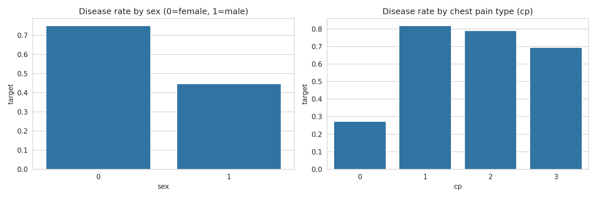
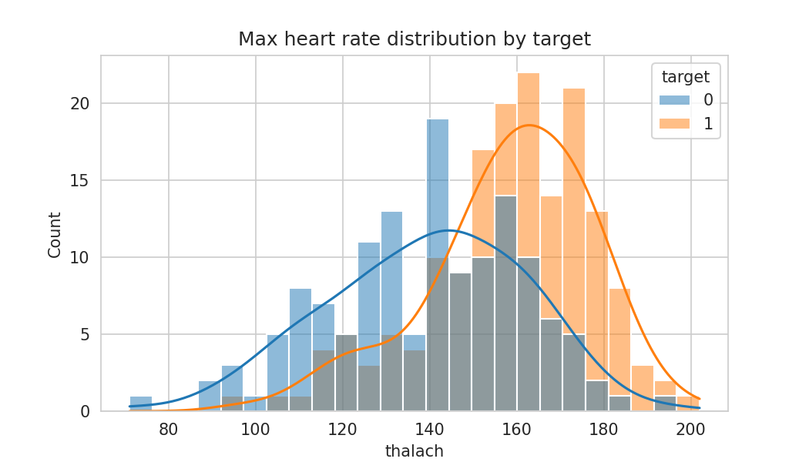
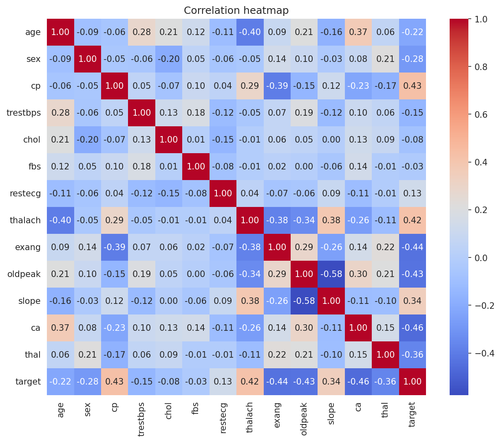
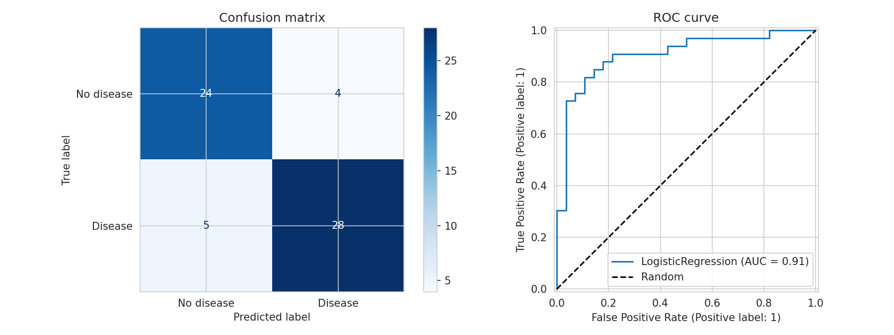
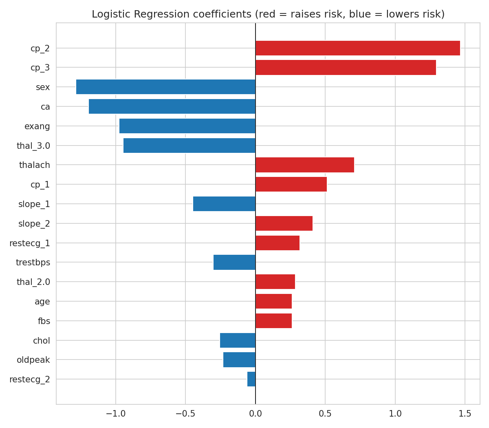

# Heart Disease Prediction

## Problem Statement
A hospital wants a first-pass screening model that flags patients at higher risk of heart disease using clinical measurements such as blood pressure, cholesterol, and heart rate. This project builds a Logistic Regression model to predict the presence of heart disease and identifies the clinical indicators most associated with the outcome.

## Dataset
- **Name:** Heart Disease Dataset
- **Source:** Kaggle (johnsmith88)
- **Link:** https://www.kaggle.com/datasets/johnsmith88/heart-disease-dataset
- **Rows / Columns:** 302 rows after removing 723 duplicate records (1,025 originally), 14 columns

## Tools Used
- Python
- Pandas, NumPy
- Matplotlib, Seaborn
- Scikit-learn
- Google Colab

## Workflow
1. Data Collection (loaded via kagglehub in Google Colab)
2. Data Cleaning: removed 723 duplicate rows; treated `ca = 4` and `thal = 0` as placeholder (missing) values and filled them with the column mode
3. Exploratory Data Analysis (EDA)
4. Feature Engineering: one-hot encoded `cp`, `restecg`, `slope`, `thal`; scaled `age`, `trestbps`, `chol`, `thalach`, `oldpeak` with StandardScaler (fit on training data only to avoid leakage)
5. Model Building (Logistic Regression, stratified 80/20 split, `random_state=42`)
6. Evaluation
7. Insights & Recommendations

## Results
- **Model:** Logistic Regression
- **Key Metrics (test set, 61 patients):** Accuracy = 0.85, Precision = 0.88, Recall = 0.85, F1 = 0.86, ROC-AUC = 0.91
- **Top Factors / Drivers** (largest model coefficients):
  1. **Chest pain type (`cp_2`, `cp_3`)**: coefficients +1.47 and +1.30. Compared with chest pain type 0, these types are strongly associated with a higher predicted probability of the positive class.
  2. **Sex (`sex`)**: coefficient -1.29. Male patients are associated with a lower predicted probability of the positive class in this dataset.
  3. **Number of major vessels (`ca`)**: coefficient -1.20. More major vessels flagged is associated with a lower predicted probability of the positive class.
  
  Other notable indicators: exercise-induced angina (`exang`, -0.98), thalassemia type 3 (`thal_3.0`, -0.95) and max heart rate (`thalach`, +0.71).

- **Correlation with target:** the strongest positive correlations were `cp` (+0.43) and `thalach` (+0.42); the strongest negative were `ca` (-0.46), `exang` (-0.44) and `oldpeak` (-0.43).

**Why recall matters:** In medical screening, missing a patient who has heart disease (a false negative) is more costly than a false alarm, so recall is reported alongside accuracy. Lowering the decision threshold from 0.5 to 0.3 raised recall from 0.85 to 0.91, at the cost of precision (0.88 to 0.81).

## Notes and Limitations
- The test set contains only 61 patients, so the metrics can change noticeably with a different split.
- Coefficients describe associations in this dataset, not causes. For one-hot columns such as `cp_2`, the coefficient is relative to the dropped baseline category (`cp_0`).
- The signs of some coefficients (for example `ca`, `exang`, `thalach`) appear opposite to what clinical knowledge would suggest for "disease". This version of the Kaggle dataset is known to have its `target` label coded differently from the original UCI data, so the results are reported as associations with the `target` column exactly as provided.

## Screenshots

## Future Improvements
- Try Random Forest and compare performance
- Use cross-validation for more reliable metrics on this small dataset
- Deploy the model as a simple web app

## Author
[Bhoomi Gupta]
